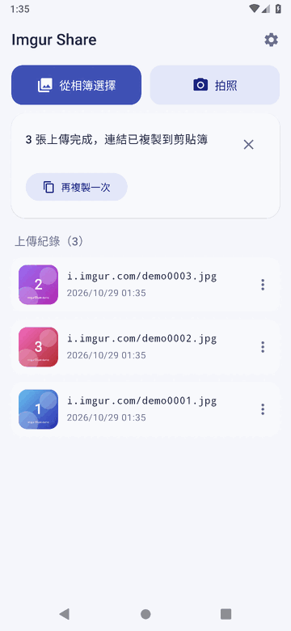
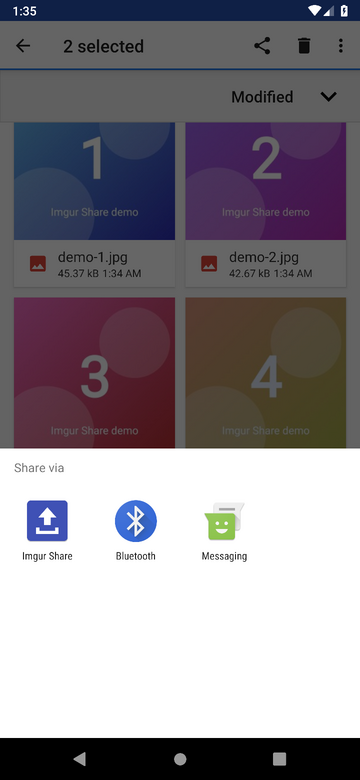
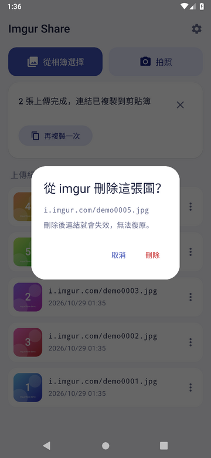
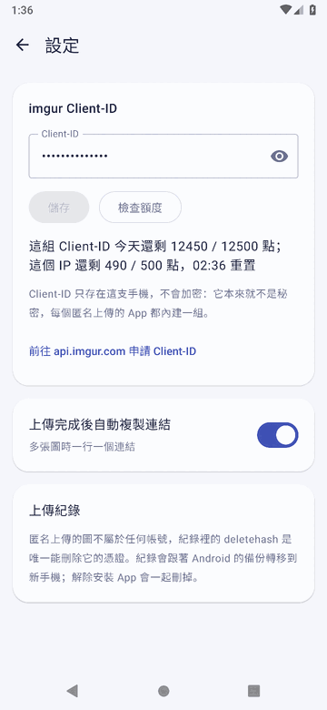

# Imgur Share

把圖片匿名上傳到 imgur、拿回連結的 Android App（Android 9 以上）。

**[下載 APK](https://github.com/twtrubiks/imgur-share/releases/latest/download/imgur-share.apk)**（[所有版本](https://github.com/twtrubiks/imgur-share/releases)）

- 從其他 App 分享圖片進來直接上傳，也可以從相簿多選或拍照
- 最多 3 張同時上傳，切到其他 App 也會傳完
- 上傳完成自動把連結複製到剪貼簿，多張就一行一個（設定裡可以關掉）
- 上傳紀錄存在手機裡，可以再複製連結，或從 imgur 刪除
- 只需要網路權限，不需要儲存、相機權限

## 畫面

2 倍速：輸入 Client-ID → 從相簿選 3 張上傳 → 從「檔案」App 分享 2 張進來 → 從 imgur 刪除一張 → 設定頁。

[完整影片（mp4）](docs/demo.mp4)

| 上傳完成 | 從其他 App 分享 | 從 imgur 刪除 | 設定 |
| :---: | :---: | :---: | :---: |
|  |  |  |  |

畫面由 GitHub Actions 的 Android 9 模擬器錄製。imgur 換成假的伺服器，圖片、連結和 Client-ID 都是測試產生的。

## 開發

Kotlin + Jetpack Compose，全程在 [Claude Code 雲端 session](https://claude.ai/code) 開發，畫面由 GitHub Actions 的模擬器錄影確認。

- 環境設定：[docs/cloud-setup.md](docs/cloud-setup.md)
- 專案約定與開發流程：[CLAUDE.md](CLAUDE.md)

## 使用

**在台灣使用要開 VPN**：imgur 封鎖了台灣地區的連線，不開 VPN 時上傳、刪除都會失敗。

使用 App 和到 imgur 申請 Client-ID 時，建議先開 VPN 連到其他國家。

我自己用的是 [Proton VPN](https://github.com/ProtonVPN/android-app/)，可以參考。

需要自己的 imgur Client-ID：到 <https://api.imgur.com/oauth2/addclient> 申請，
Authorization type 選「OAuth 2 authorization without a callback URL」，在 App 第一次開啟時輸入。

匿名上傳的圖不屬於任何帳號，紀錄裡的 deletehash 是唯一能刪除它的憑證。紀錄會跟著 Android 備份轉移到新手機，
但**解除安裝 App 會一起刪掉**。

APK 用開發環境的 debug 金鑰簽章。之後的版本如果簽章不同，要先移除舊版才能安裝，而移除會一併刪掉上傳紀錄。

⭐ **如果這個專案對您有幫助，請給一個 Star！** ⭐

## Donation

文章都是我自己研究內化後原創，如果有幫助到您，也想鼓勵我的話，歡迎請我喝一杯咖啡 :laughing:

綠界科技ECPAY ( 不需註冊會員 )

[贊助者付款](http://bit.ly/2F7Jrha)

歐付寶 ( 需註冊會員 )

[贊助者付款](https://payment.opay.tw/Broadcaster/Donate/9E47FDEF85ABE383A0F5FC6A218606F8)

## 贊助名單

[贊助名單](https://github.com/twtrubiks/Thank-you-for-donate)
